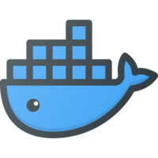
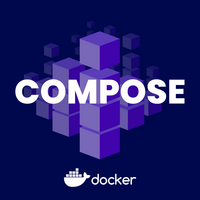
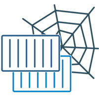
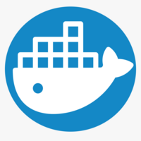
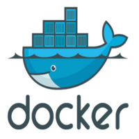
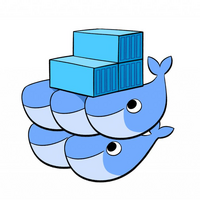
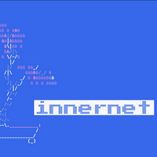
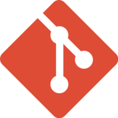

# Roles

| Logo | Role | Kind | Description |
| --- | --- | --- | --- |
|   | [acme_sh](roles/acme_sh/) | system | Issue & renew the free certificates. |
|   | [alertmanager](roles/alertmanager/) | service | Deploy Alertmanager container. |
|   | [alloy](roles/alloy/) | service | Deploy Alloy container. |
|   | [autossh](roles/autossh/) | system | Configure Autossh tunnels. |
|   | [bbb_install](roles/bbb_install/) | application | Runs the bbb-install script. |
|   | [bigbluebutton_exporter](roles/bigbluebutton_exporter/) | service | Deploy BigBlueButton exporter container. |
|   | [blackbox_exporter](roles/blackbox_exporter/) | service | Deploy Blackbox exporter container. |
|   | [bookstack](roles/bookstack/) | application | Deploy BookStack container. |
|   | [caddy](roles/caddy/) | service | Deploy Caddy container. |
|   | [cadvisor](roles/cadvisor/) | service | Deploy cAdvisor container. |
|   | [cargo](roles/cargo/) | environment | Setup Rust toolchain and cargo package manager. |
|   | [certbot](roles/certbot/) | system | Deploy Let's Encrypt certificates. |
|   | [clamav](roles/clamav/) | service | Deploy ClamAV container for antivirus scanning. |
|   | [cleanup](roles/cleanup/) | environment | Cleanup Ansible roles. |
|   | [collabora_code](roles/collabora_code/) | application | Deploy Collabora Online Development Edition (CODE) container. |
|   | [commento](roles/commento/) | application | Deploy Commento container |
|   | [coturn](roles/coturn/) | service | Deploy Coturn cotainer. |
|   | [cron](roles/cron/) | environment | Setup cron jobs. |
|   | [crowdsec_firewall_bouncer](roles/crowdsec_firewall_bouncer/) | system | Deploy CrowdSec Firewall Bouncer. |
|   | [crowdsec](roles/crowdsec/) | service | Deploy CrowdSec container. |
|   | [dind](roles/dind/) | system | Deploy Docker in Docker container. |
|   | [docker_compose](roles/docker_compose/) | system | Deploy Docker Compose project. |
|   | [docker_hosts](roles/docker_hosts/) | system | Docker hostname resolver. |
|   | [docker_network](roles/docker_network/) | system | Configures a Docker network. |
|   | [docker](roles/docker/) | system | Install Docker. |
|   | [docker_restic](roles/docker_restic/) | environment | Runs Restic in Docker container. |
|   | [docker_swarm](roles/docker_swarm/) | system | Configures Docker Swarm. |
|   | [dozzle](roles/dozzle/) | application | Deploy Dozzle container. |
|   | [dribdat](roles/dribdat/) | application | Deploy dribdat container. |
|   | [etc_hosts](roles/etc_hosts/) | environment | Add entries to /etc/hosts files. |
|   | [fail2ban](roles/fail2ban/) | environment | Install and configure fail2ban. |
|   | [fathom](roles/fathom/) | application | Deploy Fathom container. |
|   | [firehol](roles/firehol/) | system | Setup FireHOL ip blacklists. |
|   | [forgejo_runner](roles/forgejo_runner/) | service | Deploy Forgejo runner container. The runner uses the host Docker daemon to spawn jobs. |
|   | [fstab](roles/fstab/) | environment | Configure the fstab file. |
|   | [gitea](roles/gitea/) | application | Deploy Gitea container. |
|   | [git](roles/git/) | environment | Checkout Git repositories. |
|   | [grafana](roles/grafana/) | service | Deploy Grafana container. |
|   | [greenlight](roles/greenlight/) | application | Greenlight is a simple front-end application for BigBlueButton |
|   | [htpasswd](roles/htpasswd/) | service | Configure .htpasswd basic auth file. |
|   | [iam](roles/iam/) | environment | Identity and Access Management. Configure user and groups. |
|   | [infomaniak](roles/infomaniak/) | system | Manage Infomaniak domain and dns entries. |
|   | [innernet](roles/innernet/) | system | Setup WireGuard based internal network. |
|   | [jenkins](roles/jenkins/) | application | Deploy Jenkins container. |
|   | [k3s](roles/k3s/) | system | Deploy Kubernetes cluster with K3s. |
|   | [kernel](roles/kernel/) | system | Manage kernel module blacklisting. |
|   | [keycloak_client](roles/keycloak_client/) | service | Configure Keycloak client. |
|   | [keycloak](roles/keycloak/) | service | Deploy Keycloak container. |
|   | [locale](roles/locale/) | environment | Set system locale. |
|   | [loki](roles/loki/) | service | Deploy Loki container. |
|   | [mailhog](roles/mailhog/) | service | Deploy MailHog container. |
|   | [mailpit](roles/mailpit/) | service | Deploy Mailpit container. |
|   | [maintenance](roles/maintenance/) | environment | Maintains operating system and disk space. |
|   | [mariadb](roles/mariadb/) | service | Deploy MariaDB database container. |
|   | [matomo](roles/matomo/) | application | Deploy Matomo container. |
|   | [meilisearch_client](roles/meilisearch_client/) | application | Configure Meilisearch api keys and indexes. |
|   | [meilisearch](roles/meilisearch/) | application | Deploy Meilisearch container. |
|   | [meilisync](roles/meilisync/) | application | Deploy Meilisync container. |
|   | [metabase](roles/metabase/) | application | Deploy Metabase container. |
|   | [moodle](roles/moodle/) | application | Deploy Moodle Docker container. |
|   | [motd](roles/motd/) | environment | Set message of the day. |
|   | [mysqld_exporter](roles/mysqld_exporter/) | service | Deploy MySQL exporter container. |
|   | [mysql](roles/mysql/) | service | Deploy MySQL database container. |
|   | [n8n_exporter](roles/n8n_exporter/) | service | Add nginx config for N8N exporter path. |
|   | [n8n](roles/n8n/) | application | Deploy N8N container. |
|   | [nextcloud_apps](roles/nextcloud_apps/) | application | Install, update and remove Nextcloud apps. |
|   | [nextcloud_exporter](roles/nextcloud_exporter/) | service | Deploy Nextcloud exporter container. |
|   | [nextcloud](roles/nextcloud/) | application | Deploy Nextcloud Docker container. |
|   | [nginx](roles/nginx/) | service | Deploy Nginx proxy with Certbot. |
|   | [nginx_waf](roles/nginx_waf/) | service | Deploy Nginx with ModSecurity and Core Rule Set. |
|   | [node_exporter](roles/node_exporter/) | service | Deploy node-exporter container and install custom metric script. |
|   | [odoo_apps](roles/odoo_apps/) | application | Install Odoo apps from file or url. |
|   | [odoo_data](roles/odoo_data/) | application | Generate Odoo data modules. |
|   | [odoo_enterprise](roles/odoo_enterprise/) | application | Checkout the Odoo Enterprise git repository. |
|   | [odoo_exporter](roles/odoo_exporter/) | service |  Add nginx config for Odoo exporter path. |
|   | [odoo](roles/odoo/) | application | Deploy Odoo Docker container. |
|   | [odoo_repos](roles/odoo_repos/) | application | Setup Odoo modules from public or private git repos. |
|   | [ollama](roles/ollama/) | application | Setup Ollama and deploy models. |
|   | [onlyoffice_documentserver](roles/onlyoffice_documentserver/) | application | Deploy OnlyOffice Document Server container. |
|   | [openldap](roles/openldap/) | service | Deploy OpenLDAP Docker container. |
|   | [open_webui](roles/open_webui/) | application | Deploy Open WebUI container. |
|   | [packages](roles/packages/) | environment | Set env vars and install packages. |
|   | [pgadmin](roles/pgadmin/) | application | Deploy pgAdmin container |
|   | [pgbouncer](roles/pgbouncer/) | service | Deploy PgBouncer container. |
|   | [php_fpm](roles/php_fpm/) | service | Deploy PHP-FPM container. |
|   | [postfix](roles/postfix/) | service | Deploy Postfix relay host. |
|   | [postgres_exporter](roles/postgres_exporter/) | service | Deploy PostgreSQL exporter container. |
|   | [postgres](roles/postgres/) | service | Deploy PostgreSQL database container. |
|   | [prometheus](roles/prometheus/) | service | Deploy Prometheus container. |
|   | [promtail](roles/promtail/) | service | Deploy Promtail container. |
|   | [pushgateway](roles/pushgateway/) | service | Deploy Pushgateway container. |
|   | [rabbitmq](roles/rabbitmq/) | service | Deploy RabbitMQ container. |
|   | [rclone](roles/rclone/) | environment | Sync files with RClone. |
|   | [redis](roles/redis/) | service | Deploy Redis container. |
|   | [remark42](roles/remark42/) | application | Deploy Remark42 container |
|   | [resolv](roles/resolv/) | system | Manage DNS configuration. |
|   | [restic_exporter](roles/restic_exporter/) | service | Add nginx config for Restic exporter path. |
|   | [restic](roles/restic/) | environment | Configure restic and backup jobs. |
|   | [restic_server](roles/restic_server/) | service | Deploy Restic server container. |
|   | [s3cmd](roles/s3cmd/) | environment | Install and configure s3cmd. |
|   | [simple_mail_forwarder](roles/simple_mail_forwarder/) | service | Deploy Simple Mail Forwarder container. |
|   | [ssh](roles/ssh/) | environment | Configure SSH client and server. |
|   | [superset](roles/superset/) | application | Deploy Apache Superset container. |
|   | [systemd](roles/systemd/) | environment | Setup systemd service. |
|   | [timezone](roles/timezone/) | environment | Define timezone. |
|   | [ufw](roles/ufw/) | system | Configures UFW rules. |
|   | [update](roles/update/) | environment | Install system and package updates. |
|   | [vercel](roles/vercel/) | system | Manage Vercel domain and dns entries. |
|   | [wordpress](roles/wordpress/) | application | Deploy WordPress container. |
